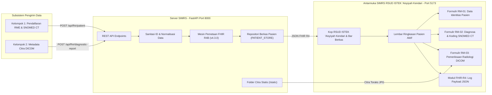

# Dokumentasi & Review Sistem: SIMRS RSUD ISTEK 'Aisyiyah Kendari — E-Health (HL7 FHIR R4)

> [!NOTE]
> Dokumen ini memuat hasil review arsitektur dan perombakan antarmuka sistem **SIMRS RSUD ISTEK 'Aisyiyah Kendari — Modul Integrasi E-Health (Kelompok 3)** berbasis standar interoperabilitas **HL7 FHIR Release 4 (`fhir.resources.R4B` v4.3.0)**, terminologi klinis **SNOMED CT**, dan pencitraan medis **DICOM**.

---

## 1. Review Sistem & Evaluasi Desain Antarmuka (Menghilangkan Ciri Khas AI Generatif)

Pada iterasi sebelumnya, antarmuka masih memiliki sejumlah karakteristik visual yang identik dengan hasil *template AI generatif*. Berikut adalah temuan review dan perubahan desain yang telah diterapkan pada `frontend/src/App.css` dan seluruh komponen React:

| Aspek Desain | Ciri Khas Template AI Generatif (Sebelum) | Desain Otentik SIMRS RSUD ISTEK 'Aisyiyah Kendari (Sesudah) |
| :--- | :--- | :--- |
| **Palet Warna & Aksen** | Warna-warni pelangi di setiap kartu (Panel 1 biru, Panel 2 hijau, Panel 3 ungu, Panel 4 kuning/oranye) dengan gradien mencolok. | Palet institusional seragam khas **'Aisyiyah / Kesehatan**: Hijau Tua Resmi (`#14532d` & `#0f3d24`), latar kertas rekam medis (`#edf1f5`), dan garis tabel tegas (`#cbd5e1`). |
| **Struktur Data & Kartu** | Kartu membulat besar (`border-radius: 14px`), bayangan mengambang (*floating shadow*), dan kotak ikon dekoratif di tiap judul. | Lembar kerja rekam medis bersekat tegas (`border-radius: 2px–3px`), kode formulir baku (**`RM-01`**, **`RM-02`**, **`RM-03`**, **`FHIR-R4`**), dan tabel spesifikasi `<th>`/`<td>` berlatar belang (*zebra table*). |
| **Header Konteks Pasien** | Banner gradien gelap dengan teks putih berkilau dan *pill* dekoratif. | **Lembar Ringkasan Berkas Pasien (`patient-summary-sheet`)** berbentuk tabel horizontal 6 kolom bersekat tegas (`No. RM`, `Nama Lengkap`, `Jenis Kelamin`, `Diagnosa Kerja`, `Pemeriksaan Radiologi`, `Status FHIR`). |
| **Ornamen & Ikon** | Penggunaan ikon berlebihan di setiap baris data (seperti ikon ✨ *Sparkles* pada tombol preset). | Menghilangkan ikon dekoratif yang tidak perlu; fokus pada keterbacaan kode klinis (`Consolas` monospace) dan istilah rekam medis Indonesia yang baku. |

---

## 2. Arsitektur Interoperabilitas Sistem

---

## 3. Spesifikasi Modul Lembar Kerja SIMRS

1. **Kop Institusi & Lembar Ringkasan Pasien (`App.jsx`)**:
   - Menampilkan identitas resmi **RSUD ISTEK 'Aisyiyah Kendari — Instalasi Rekam Medis Elektronik & Radiologi (Modul Integrasi E-Health)**.
   - Menyediakan bar **Daftar Berkas Pasien** untuk berpindah antar-pasien (`P-001` Budi Santoso, `P-002` Siti Rahma, `P-003` Ahmad Zaki, `P-004` Hendra Wijaya) secara instan.
2. **Formulir `RM-01`: Data Identitas Pasien (`PatientCard.jsx`)**:
   - Menampilkan Nomor Rekam Medis, Nama Resmi Pasien, Jenis Kelamin Administratif, ID Resource `Patient/{id}`, URI Sistem Identifier, serta fasilitas pelayanan **RSUD ISTEK 'Aisyiyah Kendari** dalam format tabel rekam medis baku.
3. **Formulir `RM-02`: Diagnosa & Koding Klinis (`DiagnosisCard.jsx`)**:
   - Menampilkan Diagnosa Kerja Utama beserta **SNOMED CT Concept ID**, tautan verifikasi ke *SNOMED CT International Browser*, klasifikasi medis dinamis, padanan kode **ICD-10**, dan unit poliklinik terkait.
4. **Formulir `RM-03`: Pemeriksaan Radiologi DICOM (`RadiologyCard.jsx`)**:
   - Menyediakan penampil citra PACS dengan kontrol fungsional (**Negatif**, **Kontras+**, **Zoom**, **Perbesar Layar Penuh**), informasi *overlay* rumah sakit (`RSUD ISTEK 'AISYIYAH KENDARI`), serta tabel metadata DICOM.
5. **Modul `FHIR-R4`: Log Payload Interoperabilitas (`FhirJsonViewer.jsx`)**:
   - Menampilkan bukti hasil serialisasi JSON `Patient`, `DiagnosticReport`, maupun `Bundle` gabungan beserta fitur salin dan unduh berkas `.json`.
6. **Formulir Integrasi Data (`InputDataModal.jsx`)**:
   - Menggunakan elemen `<fieldset>` dan `<legend>` formal untuk menguji pengiriman data baru dari Kelompok 1 dan Kelompok 2 (mendukung mode **Formulir Terstruktur** dan **Input JSON Mentah**).
